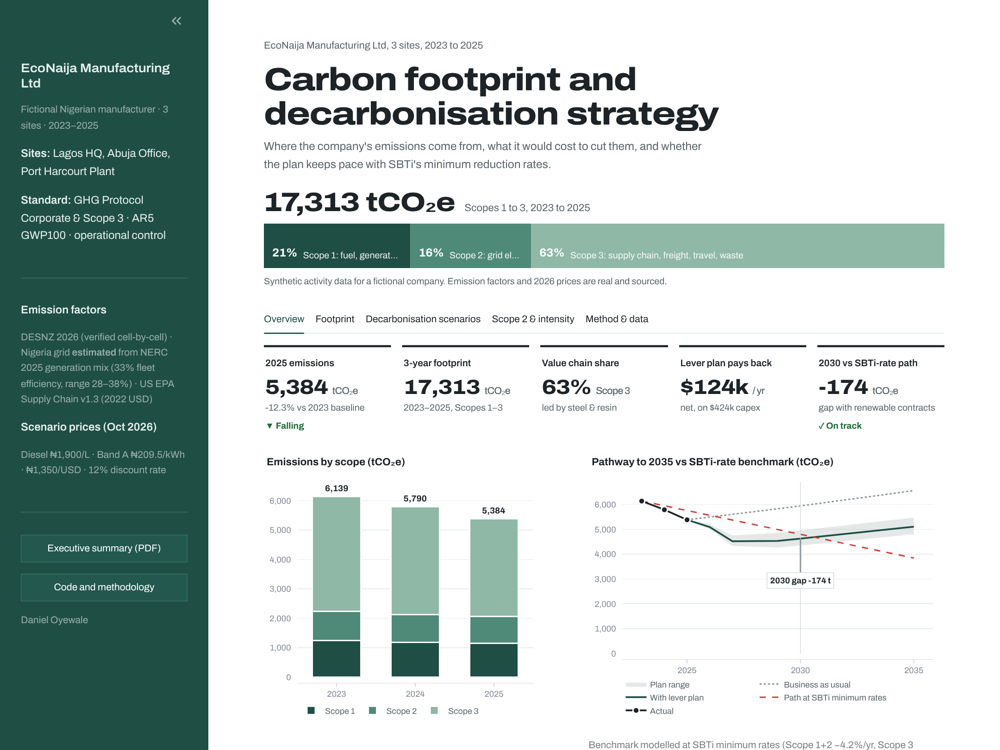
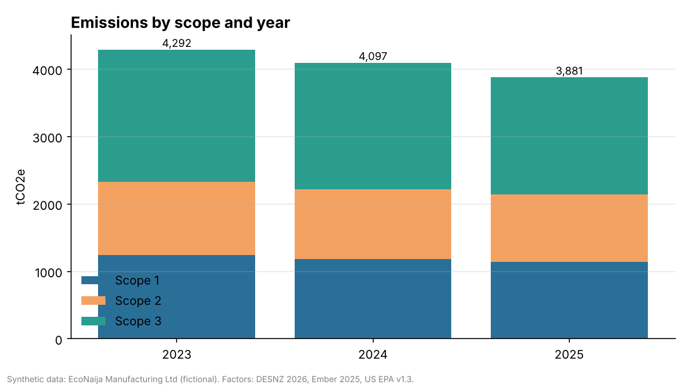
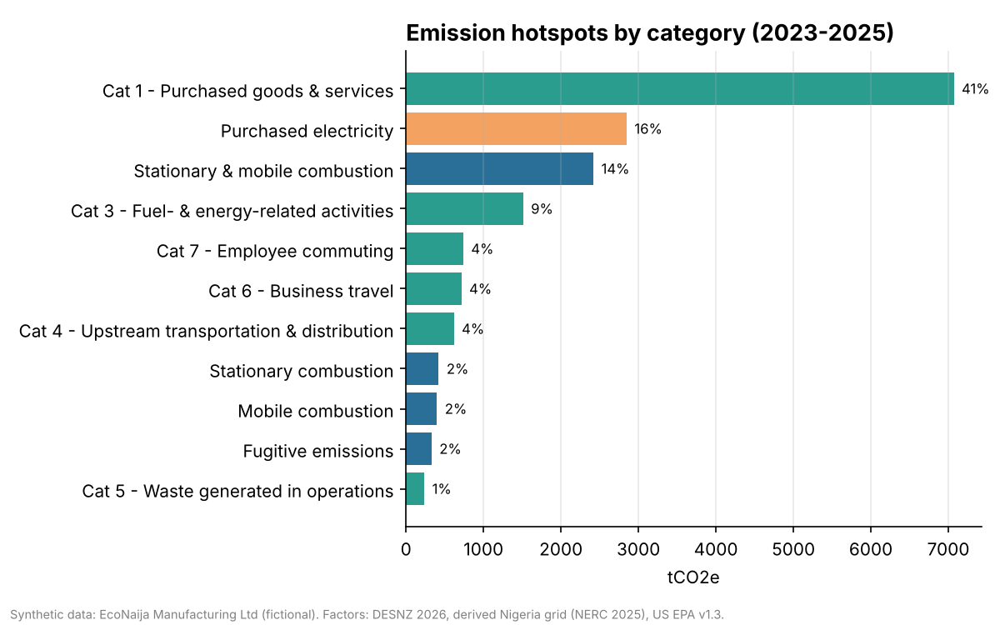
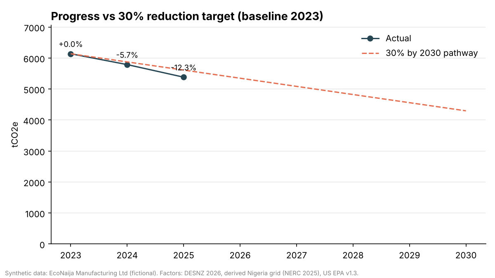
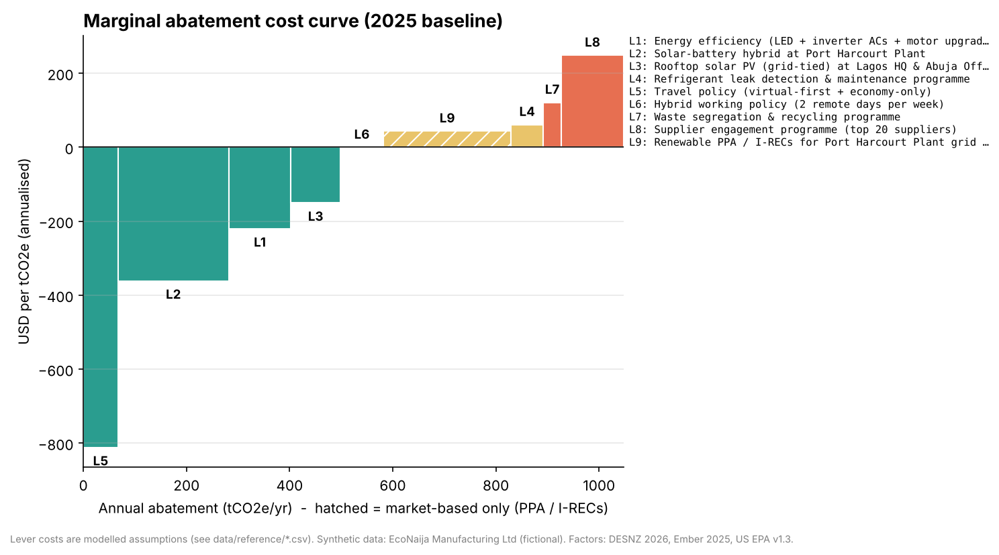
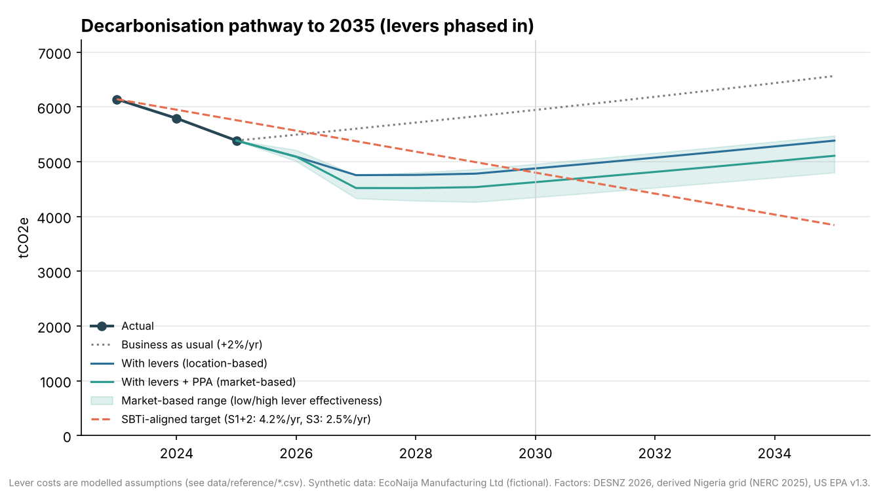
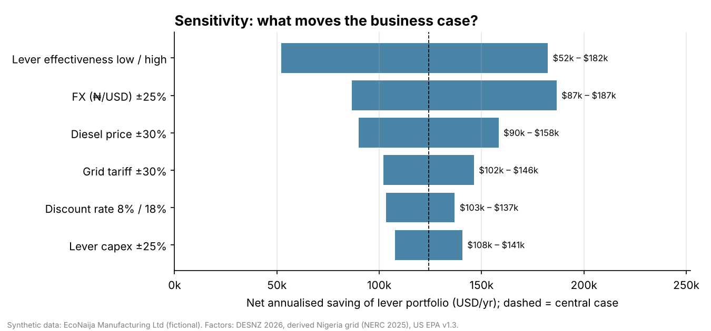

# 🌍 Carbon Footprint & ESG Dashboard

[](https://github.com/Engr-Daniel/carbon-footprint-esg-dashboard/actions/workflows/tests.yml)
 

📄 **[Executive summary (PDF, 2 pages)](reports/executive_summary.pdf)** · 📊 **[Live dashboard](https://carbon-footprint-esg-dashboard.streamlit.app/)** [](https://carbon-footprint-esg-dashboard.streamlit.app/)

End-to-end **Scope 1, 2 & 3 greenhouse gas (GHG) emissions analysis** and an **interactive ESG dashboard**, built on the [GHG Protocol Corporate Standard](https://ghgprotocol.org/corporate-standard). The case study is set in Nigeria.

> ⚠️ **Demo data:** The activity dataset is **synthetic** and belongs to a fictional company, *EcoNaija Manufacturing Ltd* (3 sites, 2023–2025). The **emission factors are real**: **DESNZ 2026** (fuels, upstream WTT, travel, waste, refrigerants), verified cell-by-cell against the official workbook; a **scope-correct Nigeria grid factor** derived from NERC 2025 generation data; and **US EPA Supply Chain Factors v1.3** (spend-based, mapped to 10 NAICS categories; spend deflated to 2022 USD). Each factor's source, year and workbook cell reference are listed in [`emission_factors.csv`](data/reference/emission_factors.csv).



---

## 📌 Business Problem
Investors, regulators and buyers are asking more and more for credible emissions disclosures. Examples include IFRS S2 / ISSB, the Nigerian SEC sustainability disclosure roadmap and supply-chain requirements. Many organisations, especially SMEs in Africa, lack a transparent and repeatable way to:
1. **Measure** their carbon footprint across all three scopes
2. **Identify hotspots** where reductions matter most
3. **Track progress** against reduction targets

This project provides a lightweight, auditable carbon accounting pipeline and a dashboard that answers all three questions.

## 🎯 Objectives
- Build a reusable emissions calculation engine (activity data × emission factor)
- Model the data relationally (SQL) for scalability
- Find emission hotspots by scope, category and site
- Track performance against a science-aligned reduction target
- Turn the findings into actionable decarbonisation recommendations

## 🗂️ Project Structure
```
carbon-footprint-esg-dashboard/
├── app/
│   └── streamlit_app.py          # Interactive dashboard
├── data/
│   ├── raw/                      # Raw inputs (git-ignored)
│   ├── processed/                # Cleaned outputs (git-ignored)
│   ├── reference/
│   │   ├── emission_factors.csv  # Emission factor library
│   │   ├── usd_deflators.csv     # US CPI-U deflators to 2022 USD (for EPA spend factors)
│   │   ├── reduction_levers.csv  # Lever sizing, capex, opex, lifetime
│   │   └── cost_assumptions.csv  # Fuel prices, tariff, FX, discount rate (sourced)
│   └── sample/
│       ├── activity_data_sample.csv  # Synthetic activity data
│       ├── company_profile.csv       # Synthetic employees / revenue / production
│       └── contractual_instruments.csv  # Synthetic PPA / I-REC examples for Scope 2 checks
├── .github/workflows/tests.yml    # CI: tests, dashboard smoke test, notebooks
├── docs/
│   ├── methodology.md            # Boundaries, scopes, assumptions
│   └── PUBLISHING.md             # Deploy / go-public checklist + LinkedIn draft
├── notebooks/
│   ├── 01_exploratory_analysis.ipynb
│   └── 02_decarbonisation_scenarios.ipynb   # MACC, pathway, sensitivity
├── reports/figures/              # Exported charts + dashboard screenshot
├── sql/
│   └── schema.sql                # Relational data model + views
├── src/carbon/
│   ├── emissions.py              # Calculation engine (multi-component factors)
│   ├── grid_factor.py            # Scope-correct Nigeria grid factor derivation
│   ├── exec_report.py            # Builds reports/executive_summary.pdf
│   ├── scenarios.py              # Levers, MACC, pathway, intensity, dual Scope 2
│   └── report_figures.py         # Exports report charts
├── tests/
│   ├── test_emissions.py         # Unit tests (pytest)
│   └── test_scenarios.py
├── AGENTS.md                     # Guide for AI coding agents / collaborators
├── MEMORY.md                     # Project decisions & context log
├── TASK.md                       # Roadmap & task tracker
├── requirements.txt              # Dashboard runtime only (Streamlit Cloud)
└── requirements-dev.txt          # Tests, notebooks, report generation
```

## 🧮 Methodology (summary)
| Scope | What it covers | Activities in this project |
|---|---|---|
| **Scope 1** | Direct emissions from owned or controlled sources | Diesel generators, fleet fuel, natural gas, LPG, refrigerant leaks |
| **Scope 2** | Indirect emissions from purchased energy | Grid electricity: combustion-only factor; location- and market-based (with instrument quality checks) |
| **Scope 3** | Other value-chain emissions | Purchased goods (**category-specific spend factors**), Cat 3 upstream fuels and grid losses, Cat 4 freight, business travel, commuting, waste |

**Formula:** `tCO2e = activity quantity × emission factor (kgCO2e/unit) ÷ 1000`

The full method is in [`docs/methodology.md`](docs/methodology.md).

## 📊 Key Findings (synthetic activity data, 2023–2025)
| Metric | Value |
|---|---|
| Total footprint (3 yrs) | **17,313 tCO2e** |
| 2025 footprint | **5,384 tCO2e** |
| Scope split | Scope 1: 21% · Scope 2: 16% · Scope 3: 63% |
| Change, 2025 vs 2023 baseline | **−12.3%** |
| Highest-emitting site | Port Harcourt Plant (56% of total) |



- **Purchased goods & services (Scope 3 Cat 1) is the #1 hotspot at 41%**, led by **steel (18%)** and **plastic resin (12%)**. Category-specific EPA factors more than doubled this estimate versus a generic average, so supplier data on these two materials is the top data-strategy priority.
- **Grid electricity (Scope 2, 16%)** and **diesel generators (Scope 1, ~14%)** come next. Nigeria's grid generation factor (0.417 kgCO2e/kWh) is about 3× the UK's, which makes on-site solar especially valuable.
- **Upstream fuel supply and grid losses (Scope 3 Cat 3, 9%)** are reported separately, so Scope 2 is combustion-only, as the GHG Protocol requires.
- **Progress:** −12.3% by 2025 (in real terms, after deflating spend) is **ahead** of the straight-line path to −30% by 2030 (−8.6% by 2025). The remaining reduction still needs structural changes.

<p float="left">
  
  
</p>

## 🛠️ Decarbonisation Strategy (scenario model)
Nine reduction levers were sized against the 2025 baseline and costed with **2026 Nigerian market prices**: diesel ₦1,900/L, Band A grid tariff ₦209.5/kWh, ₦1,350/USD. Each lever is ranked on a **marginal abatement cost curve (MACC)**.

| Result | Value |
|---|---|
| Physical abatement (8 levers) | **~968 tCO2e/yr (−18% vs 2025)** |
| + Renewable PPA / I-RECs (market-based, quality-checked) | ~1,194 tCO2e/yr (−22%) |
| Total capex | **$424k** |
| Net annualised saving | **~$124k/yr** (cash-positive in every sensitivity case, min ~$52k/yr) |
| Port Harcourt solar-battery hybrid | ~266 tCO2e/yr, **~2-year payback** |
| 2030 vs SBTi-aligned target | ✅ Met **only with renewable contracts** (−174 t, range −450 to +159 t); ❌ missed on a location basis (+77 t) |





**So what?** The first wave of levers is cost-negative and should be funded now. Levers phase in over 1–3 years, and if they underperform, 2030 slips past the target. Growth of +2%/yr also erodes the gains after 2027, so a **second wave** is needed by ~2029 to stay on an SBTi path to 2035: deeper supplier engagement, fleet conversion and more on-site solar. Explore it interactively in the dashboard's **Scenarios** tab, where you can change the diesel price, FX, discount rate, growth and lever selection.

## 🔬 Methodological rigour
| Issue | How it's handled |
|---|---|
| Lifecycle grid factors mix scopes | Nigeria grid factor **derived** ([`grid_factor.py`](src/carbon/grid_factor.py)): Scope 2 = combustion only (0.417); upstream (0.075) and T&D losses (0.039) go to **Scope 3 Cat 3**. A test checks the CSV against the derivation |
| Upstream fuel emissions | DESNZ WTT factors for every Scope 1 fuel (Cat 3) |
| Generic spend factor averages unrelated industries | Spend split into **10 NAICS-mapped categories** using the official EPA v1.3 CSV, with **CPI deflation to 2022 USD** (enforced by a unit check) |
| Market-based Scope 2 claims | `validate_instruments()` applies the **GHG Protocol Scope 2 Quality Criteria** (attribute claim, retirement, registry, vintage, market, uniqueness) before any zero factor |
| Unrealistic instant abatement | Levers **ramp up** over 1–3 years, with **low/high effectiveness bands** |
| Fragile assumptions | **Sensitivity analysis** on FX, diesel, tariff, discount rate, capex, effectiveness and growth |
| Silent drift / broken code | **GitHub Actions CI**: unit, regression and SQL-parity tests, dashboard smoke test, notebook execution |
| Traceability | Every DESNZ factor carries its workbook **cell reference**; decisions are logged in [`MEMORY.md`](MEMORY.md) |

**Known limitations:** synthetic activity data; spend-based Scope 3 uses US-economy EPA factors (category-specific, deflated to 2022 USD); UK proxies for landfill and car factors; no Nigerian residual mix. See [methodology §8](docs/methodology.md).

## 💡 Recommendations
0. **Fund the cost-negative levers first:** travel policy, the Port Harcourt solar-battery hybrid, efficiency, rooftop solar (see [notebook 02](notebooks/02_decarbonisation_scenarios.ipynb)).
1. **Supplier engagement:** collect primary data from the top suppliers. Move from a generic spend proxy to category-level (NAICS-mapped) factors, then to supplier-specific data.
2. **Solar + battery hybrid systems** at Port Harcourt Plant to cut diesel and grid dependence.
3. **Energy efficiency:** HVAC upgrades and refrigerant leak management.
4. **Travel policy:** virtual-first meetings and fewer long-haul flights.
5. **Set a formal target** aligned with SBTi, and report annually using this pipeline.

## 🚀 Getting Started
```bash
git clone https://github.com/Engr-Daniel/carbon-footprint-esg-dashboard.git
cd carbon-footprint-esg-dashboard
python -m venv .venv && source .venv/bin/activate   # Windows: .venv\Scripts\activate
pip install -r requirements-dev.txt   # dashboard only: requirements.txt

# Run the dashboard
streamlit run app/streamlit_app.py

# Run tests
pytest -q

# Regenerate report charts and the executive summary PDF
python src/carbon/report_figures.py && python src/carbon/exec_report.py
```

## 🛠️ Tech Stack
Python (pandas, plotly, matplotlib, reportlab) · Streamlit · SQL (SQLite/PostgreSQL) · Jupyter · pytest · GitHub Actions

## 📚 Data Sources & References
- [GHG Protocol](https://ghgprotocol.org/) – Corporate Standard & Scope 3 Standard
- [UK DESNZ – GHG Conversion Factors 2026](https://www.gov.uk/government/publications/greenhouse-gas-reporting-conversion-factors-2026) (published June 2026, AR5 GWP100)
- [NRGI (2026) – Nigeria's gas-to-power ambitions](https://resourcegovernance.org/sites/default/files/2026-07/Nigeria_gas_power_limits_opportunities_alternatives.pdf) (NERC 2025 generation mix) · [NERC Q1 2024 report](https://nerc.gov.ng/wp-content/uploads/2024/07/2024_Q1-Report_v1YA.pdf) (transmission loss factor)
- [Ember – Yearly Electricity Data](https://ember-energy.org/data/yearly-electricity-data/) (lifecycle cross-check, CC BY 4.0)
- [GHG Protocol Scope 2 Guidance](https://ghgprotocol.org/scope-2-guidance) (quality criteria, dual reporting)
- [US EPA – Supply Chain GHG Emission Factors v1.3](https://doi.org/10.23719/1531143) (USD 2022)
- [SBTi Corporate Near-Term Criteria](https://sciencebasedtargets.org/) – 4.2%/yr (Scope 1+2), 2.5%/yr (Scope 3) minimum rates
- Cost data: NBS / depot diesel and petrol prices (2026), NERC Band A tariff, 2026 Nigerian solar market pricing
- IPCC AR5 – Global Warming Potentials
- IFRS S2 – Climate-related Disclosures

## 👤 Author
**Daniel Oyewale**, Data Analyst · Data Strategist · Sustainability Researcher at [Petgrave.io](https://petgrave.io)

## 📄 License
MIT. See [LICENSE](LICENSE).
